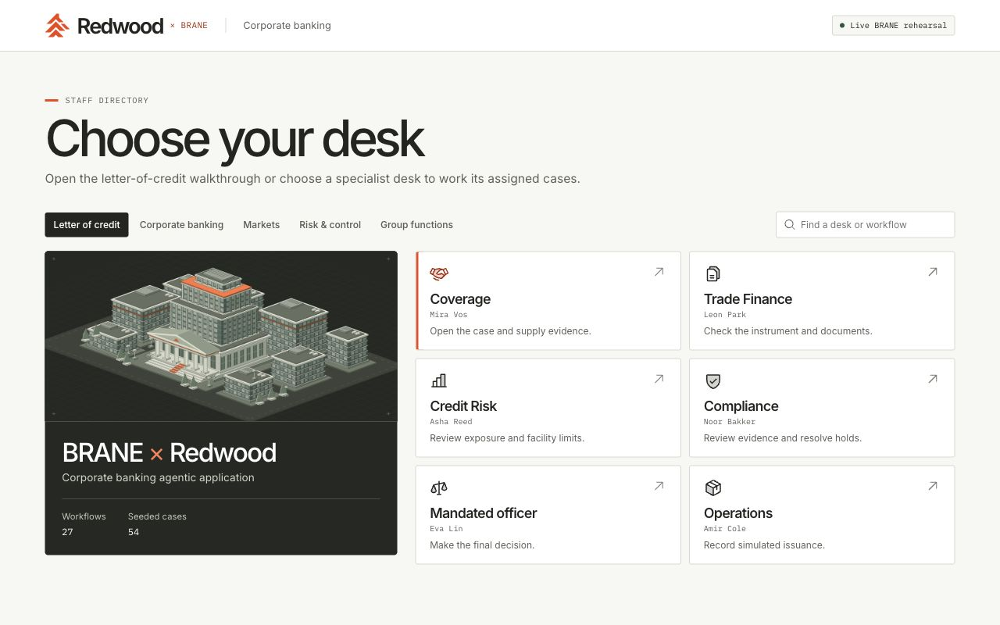

# Redwood

Redwood is a corporate banking workspace with **27 workflows and 54 seeded cases**. The original USD 2 million letter of credit brings six people together across the bank. Another 26 specialist desks handle work such as returned payments, covenant exceptions, FX handovers and audit findings. The organizer prepares drafts. Assigned staff review the evidence and a separate human records the final decision.

**Judges and presenters** can open the [submission guide, live results and backup walkthrough](SUBMISSION.md).



## Run from a fresh clone

Install Python 3.11+ and Node 22.12+ with npm, then run these commands from the repository root.

```sh
make setup
make run
```

Open [the local staff console](http://127.0.0.1:8000) and choose **Coverage**. The agent dashboard shows that desk’s assigned requests, the organizer’s routing map and recent case activity. **Preview route** animates a sample handoff. **Run analysis** prepares the three fixture packets and **Replay run** animates the recorded handoffs. **Open case** takes you to the desk’s actions and evidence. Use **Switch desk** to continue as another employee. Both the offline console and the isolated live rehearsal support one-click desk entry. A persistent staff deployment uses individual tokens.

Setup installs the dependencies, builds the React console, creates the six original demo identities and two identities per specialist desk, seeds SQLite and prepares evidence worksheets. An existing checkout can run `make seed` and `make build`, then restart its server to pick up the new directory. Setup keeps existing cases, logins and worksheet edits. The default mode runs entirely on local fixtures after installation. The console uses Neue Haas Grotesk Display when installed and bundles Inter, IBM Plex Mono and its icons for offline use. [Bundled font and icon licenses](console/public/design-licenses.txt)

## Try a specialist desk

1. Choose **Corporate banking → Payments & Cash**. The analyst’s dashboard opens with two cases. Select **PAY-001** and click **Run analysis**. The routing map follows evidence review, policy review and the handover draft.
2. Click **Open case**. Expand the evidence packet to inspect the return-match record. Enter a reason and click **Sign desk review**. Use **Switch desk → Operations** to sign the assigned Operations review on the same case. The picker suggests the next required reviewer.
3. Click **Switch desk** again. The picker selects the Payments approver. Open that desk, enter a reason and click **Confirm the return match** or **Refer for further review**. The outcome and its reference appear in the file.
4. Try **PAY-002** as the analyst for an incomplete record. **Verify supporting record** creates revision 2. Run the organizer again to prepare that revision for the human reviewers. **New case template → Open example case** opens another independent copy of either scenario.

Use the four department groups or search for a desk. Each specialist has its own examples, prompts, evidence and final action. M&A, AML & Financial Crime and Regulatory Surveillance keep all three drafting tasks inside the bank. The other 23 specialist desks use BRANE in live mode. All outcomes are simulated internal records. [Browse the 26 desks and their examples](docs/department-workflows.md) · [See the organizer running a payment case](docs/evidence/specialist-workflow.jpg)

## Run the live BRANE rehearsal

On a fresh clone, copy `.env.example` to `.env` and put the assigned AI-Z team credential in `BRANE_API_KEY`. The rehearsal reads the BRANE variables from that file. Run the following after `make setup`.

```sh
make brane-check
make run-live
```

Open the [live staff console](http://127.0.0.1:8001). Choose **Coverage**, then **Run analysis**. This loopback-only launcher creates temporary synthetic cases and desk identities. Stopping the live rehearsal discards its cases. Starting it again gives the next presenter a clean run. The offline console keeps its own SQLite file.

## Walk the case

Choose the named role on the desk picker. The dashboard refreshes automatically while visible. Use **Open case** for findings, messages and decisions. From that screen, **Switch desk** opens the picker and returns the next assigned reviewer directly to the same case. In the case workspace, click **Refresh** when returning to an already-open tab.

1. **Coverage** (`coverage`) selects `LC-001` in the queue and clicks **Run analysis**.
2. **Credit Risk** (`credit_risk`) chooses **Clear**, enters a reason and clicks **Sign desk finding**. **Compliance** (`compliance`) chooses **Hold** and **Invoice required**, enters a reason and signs. Coverage receives the request.
3. **Coverage** refreshes, selects the Compliance request under **Attach supplier invoice**, enters an evidence note, then clicks **Attach invoice and revise file**. Click **Run analysis** for revision 2. The hold stays open and the earlier Credit signature is historical.
4. **Trade Finance** (`trade_finance`) and **Credit Risk** each sign **Clear** on revision 2. **Compliance** chooses **Clear**, selects its open hold, selects `DOC-INV-01@1` as the reviewed evidence, enters a reason and signs.
5. **Final officer** (`final_officer`) selects **Approve**, enters a reason and clicks **Record final decision**. **Operations** (`operations`) clicks **Simulate issuance**. Refresh the case to see the same saved receipt.

`LC-002` starts with a complete invoice. Use it to demonstrate that a Compliance hold alone prevents final approval. `make reset` replaces the local demo cases with their original seeded state and keeps logins and evidence worksheets. Stop the local server before resetting a rehearsal.

## Team entry points

| Owner | Start here | Handoff |
| --- | --- | --- |
| Matvei | [BRANE setup](policy/README.md), [BRANE connection](backend/brane_client.py), [case access interface](backend/integrations.py) | Maintain the assigned department, committed policy and measured gateway results. |
| Tasos | [Synthetic case and facility](data/trade/demo.json), [agent runtime](backend/agent/runtime.py), [packet display](console/src/PacketList.tsx) | Supply validated desk packets through `prepare_packets(snapshot, mode, run_id=…, authorize=…)`. Each fact carries a case-scoped versioned source. |
| Ilaria | [Case answer key](legal/case-answer-key.md), [evidence instructions](docs/evidence/README.md), [utility scorecard](eval/utility-scorecard.csv) | Maintain the case answer key, cited matrix and business evidence. |
| Nikita | [Case API](backend/main.py), [workflow](backend/workflow.py), [staff console](console/src/main.tsx), [API tests](tests/test_trade_workflow.py) | Own the six-role workflow, the live rehearsal and the simulated receipt. |

## Developer commands

| Command | Result |
| --- | --- |
| `make test` | Run the backend and workspace checks against disposable data. |
| `make evidence` | Exercise holds, revisions, receipt retries, the bank outage and five fault scenarios with dummy credentials, and run both fixture scenarios. Save results under `.clearance/evidence/`. |
| `python -m tools.agent_utility` | Score both synthetic revisions against Ilaria's answer key and export `.clearance/evidence/agent-utility-fixture.json`. |
| `make doctor` | Check local database, logins, console build and configured mode. |
| `make brane-check` | Read the assigned department and verify its active policy against the committed hardened rules. |
| `make run-live` | Launch the one-click live rehearsal on port 8001 with an isolated database. |
| `make live-evidence` | Exercise both revisions and all six human roles through the API and BRANE. Export measured results to `.clearance/evidence/submission-live.json`. |
| `.venv/bin/python -m tools.department_rehearsal` | Rehearse the first example and record a human outcome at each specialist desk. Add `--mode live` to use the assigned BRANE service on permitted cases. |
| `make dev-console` | Run the Vite development server on port 5173. Run the API on port 8000 alongside it. |
| `make build` | Type-check and bundle the console for the single-origin server. |

The API reference is at [local OpenAPI docs](http://127.0.0.1:8000/docs). Configuration variables are listed in [.env.example](.env.example). Shell variables take precedence over the BRANE settings in the local file. [Full specification](docs/corporate-banking-hackathon-spec.md) · [Who builds what](docs/team-build-plan.md) · [Specialist workflow directory](docs/department-workflows.md)

The bank calculates capacity, looks up evidence and retrieves the current synthetic policy. The drafting prompt contains the desk, the next-step code and two approved wordings. The bank validates the returned wording and attaches the local figures and citations. The live rehearsal records the observed model, usage, policy digest, request IDs, decisions and simulated receipt. [BRANE setup](policy/README.md) · [Case answer key](legal/case-answer-key.md)
