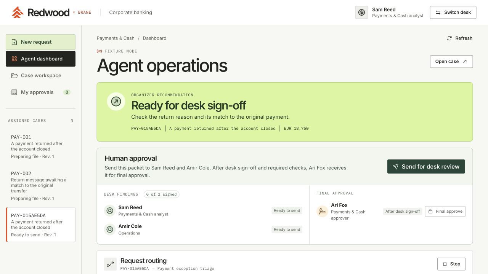

# Redwood

Redwood helps corporate banking staff prepare a case for a human decision. In the example, a relationship manager requests a **USD 2 million letter of credit**. Trade Finance checks the documents, Credit Risk calculates the remaining capacity, and Compliance flags a missing supplier invoice. Once the invoice arrives, all three desks sign the revised file. A separate officer approves it, and Operations records a simulated issuance. All cases and staff identities are synthetic.



## Run Redwood

Install Python 3.11+ and Node.js 22.12+ with npm. From the repository root, run these commands.

```sh
make setup
make run
```

Open the [local console](http://127.0.0.1:8000), choose **Coverage → LC-001**, and select **Run analysis**. This mode uses offline fixtures.

For a live demo, copy `.env.example` to `.env`, set `BRANE_API_KEY` to the assigned department credential, then run `make brane-check` and `make run-live`. Open the [live console](http://127.0.0.1:8001). The demo guide takes the case from the first finding to the signed decision and receipt. [Live demo guide](docs/demo-guide.md#walk-the-case)

## How a case stays under bank control

- **The bank prepares the facts.** Bank code reads the records each desk may see, checks facility limits and attaches citations. For the letter of credit, each desk’s model chooses between two approved wordings for the next step. Customer notes, amounts and account references stay in the bank. [Drafting code](backend/agent/runtime.py) · [Case rules and expected results](legal/case-answer-key.md)
- **BRANE checks each model request.** The adapter verifies the active policy before sending approved wording. A failed policy check stops the analysis. In the outage test the bank attempted one policy lookup, sent zero model requests and left the case pending. [BRANE adapter](backend/brane_client.py) · [Outage record](docs/evidence/firewall-outage.json)
- **People sign the current revision.** An open Compliance hold blocks approval. Adding material evidence requires fresh signatures. The final decision and simulated issuance belong to separate staff roles. [Live case, signatures and receipt](docs/evidence/submission-live.json)

## Business case

The relationship manager and three reviewing desks work from the same evidence and can see which signature or document is outstanding. In one live run Redwood prepared and checked six cited drafts across two revisions in **29.55 seconds**. A second run took **47.63 seconds**. The team estimated that manual preparation took about twice as long as the first run, or **roughly 59 seconds**. Separate manual stopwatch readings are unavailable. Both measured runs exclude time spent waiting for documents, reviewing the drafts and signing. [Timing data](docs/evidence/preparation-times.csv) · [Second run](docs/evidence/readiness-live.json)

The same review flow supports 26 additional desks. In a live run using scripted staff identities, all 26 reached a signed outcome. Three restricted workflows ran entirely inside the bank. [Desk workflows](docs/department-workflows.md) · [Recorded outcomes](docs/evidence/department-rehearsal-live.json)

## Governance and test results

| Project record | What it shows |
| --- | --- |
| [Legal assessment](docs/legal-position.md) and [department research](research/bank-data-classification/README.md) | The proposed bank deployment, its legal bases, provider and transfer conditions, and the data each desk needs. |
| [Policy matrix](submission/MAIN_Policy_Matrix_Template.csv) | Eleven rules linking data categories and legal sources to implemented controls, observed results and remaining gaps. |
| [Test protocol](submission/MAIN_Five_Tests_Template.csv) | Results for permitted requests, protected and repeated details, embedded instructions, and an unavailable firewall, plus five banking edge cases. |
| [Security findings](evidence/REPORT.md) and [application evidence](docs/evidence/README.md) | The application excluded every planted private field across six observed requests. In separate raw-text tests the gateway missed a name variant and masked ordinary trade wording. |

Use `make test` to run the automated suite and `make evidence` to reproduce the local fixture and outage checks. From a Git checkout, `make submission` packages the committed source and evidence into a ZIP.
